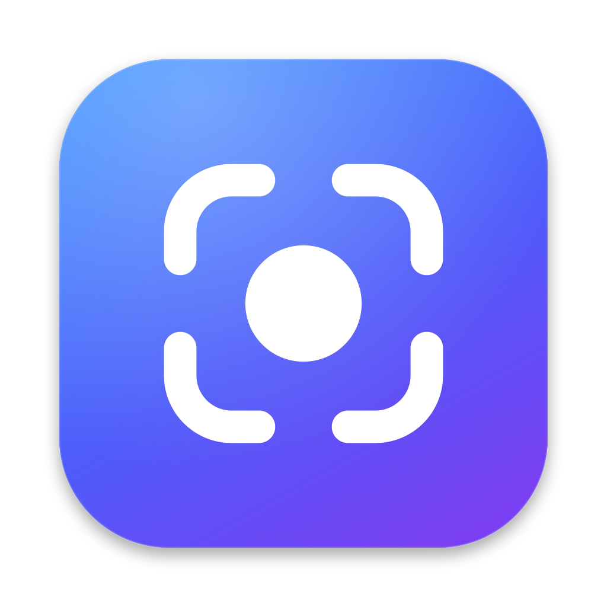

<p align="center"></p>

<h1 align="center">Glint</h1>

<p align="center">Fast, local-only screenshots for macOS. Capture, annotate, pin, and share without an account or a cloud.</p>

Glint lives in your menu bar. Take a screenshot and it shows up as a small popup in the corner of your screen. Copy it, save it, drag it into another app, or open it in the editor to mark it up.

## Features

- **Capture**: area, previous area, fullscreen, window, self-timer, and the **Capture Bar**, a selection overlay with capture modes and exact W × H fields.
- **Popup**: every capture appears as a card at the edge of the screen. Hover for Copy, Save, Annotate, Pin and Extract Text. You can also drag it into any app, swipe it away, or press Space for Quick Look.
- **Editor**: a canvas-first window with a floating tool rail.
  - Rectangles, ellipses, lines, arrows (standard, fancy, curved, double), text in several styles, pixelate and blur, spotlight, numbered counters, pencil and marker.
  - Crop and resize.
  - A background tool for padding, gradients, wallpapers, shadow and rounded corners.
- **Pins**: float any screenshot above your windows. Zoom it, change its opacity, or lock it so clicks pass through.
- **Text recognition**: select an area and its text is copied to your clipboard.
- **Scrolling capture**: scroll by hand or turn on Auto-Scroll. Glint stitches the frames into one tall image and shows a live preview.
- **Capture history**: browse past captures and bring any of them back as a popup.
- **Settings**: after-capture actions, recordable shortcuts, popup position and auto-close, pin style, history retention.

Everything stays on your Mac: captures are saved locally, and Glint makes no network requests.

## Default shortcuts

| Action | Shortcut |
|---|---|
| Capture Bar | ⌃⇧2 |
| Capture Area | ⌃⇧4 |
| Capture Previous Area | ⌃⇧6 |
| Capture Fullscreen | ⌃⇧3 |
| Capture Window | ⌃⇧5 |
| Self-Timer | ⌃⇧7 |
| Capture Text | ⌃⇧1 |

You can change all of them in Settings → Shortcuts. Scrolling Capture, Capture History and Restore Last Capture have no shortcut until you set one.

In the editor, single letters pick tools: V select, R rectangle, F filled rectangle, E ellipse, L line, A arrow, T text, P pixelate, H spotlight, C counter, D pencil, M marker. K crops and B opens the background panel.

## Install

Download the latest `Glint-<version>.dmg` from [Releases](../../releases) and drag Glint to Applications.

Release builds are signed ad hoc and not notarized, so macOS blocks the first launch. Right-click Glint → **Open**, or run:

```bash
xattr -dr com.apple.quarantine /Applications/Glint.app
```

On first use, Glint asks for:
- **Screen Recording**, to take screenshots.
- **Accessibility**, for the popup's hover shortcuts, swipe-to-dismiss, Auto-Scroll, and Esc/Return in the overlays.

Requires macOS 14 or later.

## Build from source

You only need the Xcode Command Line Tools; full Xcode isn't required.

```bash
./build.sh        # builds build/Glint.app
./build.sh run    # builds and relaunches it
build/Glint.app/Contents/MacOS/Glint --self-test
build/Glint.app/Contents/MacOS/Glint --demo-editor   # opens the editor on a generated sample image
```

`build.sh` signs with your first "Apple Development" identity when you have one. A stable signature keeps the Screen Recording permission across rebuilds; without one, it signs ad hoc.

Pushing a `v*` tag runs the **Build DMG** workflow, which attaches `Glint-<version>.dmg` to a GitHub release.

## Project layout

```
Sources/Glint/
  App/       menu bar app, hotkeys, settings (+ window), self-test, demo mode
  Capture/   screencapture / ScreenCaptureKit capture, OCR, scrolling stitcher
  Output/    clipboard, save, file naming
  Popup/     popup cards
  Pin/       pinned screenshots
  Editor/    editor, hand-drawn icons, background tool
  Overlay/   Capture Bar, capture history, scrolling session
Resources/   Info.plist, app icon (+ make-icon.swift that renders it)
```

## Contributing

Issues and pull requests are welcome. Keep changes small and focused. Run `--self-test` before you open a pull request, and include a screenshot for UI changes. `--demo` and `--demo-editor` let you work on the UI without capturing your own screen.

## License

Copyright (C) 2026 Heet Patel

Glint is free software: you can redistribute it and/or modify it under the terms of the GNU General Public License as published by the Free Software Foundation, either version 3 of the License, or (at your option) any later version.

Glint is distributed in the hope that it will be useful, but WITHOUT ANY WARRANTY; without even the implied warranty of MERCHANTABILITY or FITNESS FOR A PARTICULAR PURPOSE. See the [GNU General Public License](LICENSE) for more details.
